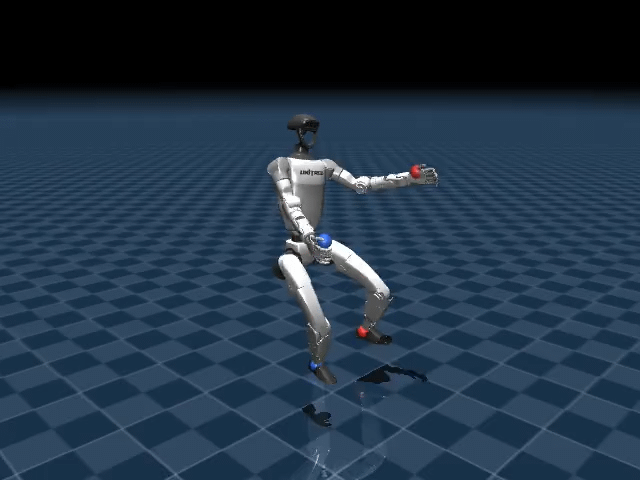
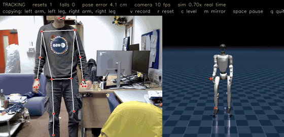

# pose-to-biped

Teaching a simulated Unitree G1 humanoid to copy a person's pose while keeping its balance, with reinforcement learning in MuJoCo. The long-term aim is to drive the robot from a live body tracker, and the first version of that is here: the simulated robot copies the person in front of your webcam. This README covers the simulation, the reinforcement learning and the webcam demo; the `pose/` folder will be documented separately.



One policy drives 23 of the G1's 29 joints (the wrists are held still). It is given target positions for 12 body keypoints (hands, feet, elbows, knees, shoulders and hips) and is rewarded first for staying balanced and then for matching the pose. It is trained with PPO from [Stable-Baselines3](https://github.com/DLR-RM/stable-baselines3) on a library of 120 reference motions.

**Stage 1 results** (60 million steps, log in [`logs/pose_stage1T1/progress.csv`](logs/pose_stage1T1/progress.csv)): test survival rose from 13 % to 89 % of each 10 s test episode, episodes ending in a fall dropped from 34 % to 4.5 %, and the average keypoint error fell from 8.8 cm to 5.6 cm.

## Contents

- [What's in the repository](#whats-in-the-repository)
- [Installation](#installation)
- [Quick start: watch a trained policy](#quick-start-watch-a-trained-policy)
- [Examples](#examples)
  - [Copy a person with your webcam](#copy-a-person-with-your-webcam-live_posepy)
  - [Record your own motions](#record-your-own-motions-record_motionpy)
  - [Fine-tune on new motions](#fine-tune-on-new-motions-finetunepy)
  - [Train a policy](#train-a-policy-train_pose_trackingpy)
  - [Make GIFs of checkpoints](#make-gifs-of-checkpoints-gif_makerpy)
  - [Build motion libraries](#build-motion-libraries-make_motionspy)
  - [Drive the G1 with the keyboard](#drive-the-g1-with-the-keyboard-keyboard_controlpy)
  - [Use the environment in your own code](#use-the-environment-in-your-own-code)
- [Troubleshooting](#troubleshooting)
- [Other files](#other-files)
- [Pose detection](#pose-detection)

## What's in the repository

Only the parts used for reinforcement learning are listed here.

```
src/G1_tele/                    the Python package (installed by `pip install -e .`)
  envs/
    pose_tracking.py            G1-pose-tracking: the whole-body pose-tracking environment
    live.py                     G1-pose-live: the same, following a live reference (e.g. a camera)
    whole_body.py               29-joint G1 base: PD control, joint armature, torque limits
    walker.py                   G1-walker: the 12 leg motors only, for Unitree's walking policy
  motion/
    library.py                  reference-motion files (.npz): load, save, merge
    synthetic.py                generates balanced whole-body motions with inverse kinematics
    retarget.py                 turns tracker keypoints into a full robot pose
    human.py                    turns MediaPipe body landmarks into robot keypoints
    recording.py                cleans camera recordings into training motions
    kinematics.py               forward kinematics and the keypoint definitions
  teleop.py                     person -> robot: find a torso, reset into their pose, follow them
  policies/
    pose_tracking.py            the actor-critic network used for training
    motion.pt, g1.yaml          Unitree's pretrained walking policy and its settings
  assets/
    g1_description/             Unitree G1 models (MuJoCo .xml, .urdf) and meshes
    motions/synthetic.npz       the default motion library: 120 clips, 42.8 min
    motions/human/<name>/       your own recordings (record_motion.py), one file per slot
examples/RL/
  live_pose.py                  the robot copies the person in front of your webcam
  record_motion.py              record motion data from a webcam, unattended
  finetune.py                   keep training a policy on new motions
  train_pose_tracking.py        train, test and watch policies
  run_logging.py                logs, evaluation videos, checkpoints and the curriculum
  gif_maker.py                  turns checkpoints into GIFs (no window needed)
  make_motions.py               builds or extends the motion library
  show_policy.py                minimal example of calling visualise() from your own script
examples/keyboard_control.py    drive the G1 with the arrow keys using the pretrained walking policy
examples/live_pose.py           a copy of examples/RL/live_pose.py
logs/
  pose_stage1/checkpoints/      a stage 1 checkpoint from 30 % of training (18 M steps), with a GIF of it
  pose_stage1T1/                the final stage 1 model (60 M steps) and its training log
  plotter.py                    plots the episode reward of every run under logs/
assets/                         pictures and videos for this README (demo.mp4: a webcam session)
```

## Installation

You need Python 3.10 to 3.12. Training has been run on Linux. macOS and Windows should work too; see [Troubleshooting](#troubleshooting). Training runs on the CPU, so you don't need a GPU. A GPU is only used to render evaluation videos on machines without a screen.

```bash
git clone https://github.com/shepai/pose-to-biped.git
cd pose-to-biped
python3 -m venv .venv
source .venv/bin/activate              # Windows: .venv\Scripts\activate

# Optional: CPU-only PyTorch, a much smaller download if you have no NVIDIA GPU
pip install torch --index-url https://download.pytorch.org/whl/cpu

# The G1_tele package, plus numpy, torch, mujoco, gymnasium, opencv, tqdm and rich
pip install -e .

# Training, videos and GIFs
pip install stable-baselines3 imageio imageio-ffmpeg pillow

# The webcam demo (MediaPipe body tracking)
pip install "mediapipe==0.10.14"

# Optional: live training curves
pip install tensorboard
```

**Install with `-e` (editable mode).** The robot model, meshes, motion library and walking policy sit inside `src/G1_tele/`, but they aren't declared as package data. A plain `pip install .` copies the code without them, and the environments then can't find their files.

**Linux without a screen** (a server, or over SSH): evaluation videos are rendered with EGL, which needs the system OpenGL libraries.

```bash
sudo apt install libegl1 libgl1
# fallback if EGL doesn't work: sudo apt install libosmesa6 && pip install PyOpenGL
```

**Check the installation.** Run these commands from the repository root:

```bash
python examples/RL/train_pose_tracking.py check
```

This builds the environment, runs 10 episodes with no corrections from the policy, and prints the sizes and simulation speed. It should start with:

```
obs (240,) (actor sees the first 221), action (23,), 120 clips, 42.8 min of motion
```

The untrained robot falls within a couple of seconds; that's expected. Then check that videos can be recorded:

```bash
python examples/RL/train_pose_tracking.py video
```

This tries each OpenGL backend (`glfw`, `egl`, `osmesa`) and the video writers, then records a short clip to `logs/video_test/`. If videos don't work, it tells you which `MUJOCO_GL` setting to use. Training works without videos.

## Quick start: watch a trained policy

The repository includes the final stage 1 model (60 million steps) and a checkpoint from 30 % of the way through (18 million steps):

```bash
# Opens a MuJoCo window. Red spheres are the left-side targets, blue the right.
python examples/RL/train_pose_tracking.py play logs/pose_stage1T1/pose_stage1T1

# The 30 % checkpoint, to compare
python examples/RL/train_pose_tracking.py play logs/pose_stage1/checkpoints/pose_stage1_030pct_18.0M

# No screen? Record a GIF instead.
python examples/RL/gif_maker.py logs/pose_stage1T1/pose_stage1T1 --out stage1_final.gif

# Or have it copy you through your webcam
python examples/RL/live_pose.py
```

Run all commands from the repository root: runs are written to `logs/` in the current folder.

## Examples

### Copy a person with your webcam (`live_pose.py`)

The trained policy follows a person in front of a camera. [MediaPipe Pose](https://github.com/google-ai-edge/mediapipe) finds the person's body in each frame, and the simulated G1 copies them while keeping its balance.



The full 27 s session is in [`assets/demo.mp4`](assets/demo.mp4). Near the end a deep squat with the arms out makes the robot fall a few times, and each time it is reset into the person's pose.

```bash
python examples/RL/live_pose.py                           # webcam 0, the final stage 1 model
python examples/RL/live_pose.py --camera 1                # another camera
python examples/RL/live_pose.py --video clip.mp4 --loop   # a video file instead of a webcam
python examples/RL/live_pose.py --record live.mp4         # record from the start (or press v any time)
python examples/RL/live_pose.py --model logs/pose_stage1/checkpoints/pose_stage1_030pct_18.0M
```

One window shows the camera, with the MediaPipe skeleton drawn on it, next to the robot. The robot's target keypoints are drawn as spheres (red = left, blue = right).

- **Finding you:** nothing happens until your torso (both shoulders and hips) has been visible for 8 camera frames. Then the robot is reset into your pose, and the policy starts following you.
- **Losing you:** if you leave the picture, the robot holds your last pose for 2 s. If you come back in that time it carries on. Otherwise it eases back to standing, and the next time you're found it resets into your pose again.
- **Falls:** if the robot falls, it is reset into your current pose.
- **Arms or legs out of view:** these stay in the robot's default pose. Sitting at a desk with only your upper body visible works: the robot stands and copies your arms and torso.
- **Camera tilt:** "up" is taken from your torso when you're first found, which corrects a tilted camera. Stand or sit upright as you step in, or press `c` to do it again.

The robot copies your pose relative to your hips. Turning on the spot and walking around aren't copied. Stepping on the spot and lifting a foot are.

| Key | Action |
|---|---|
| `v` | start / stop recording a video |
| `r` | reset the robot into your pose now |
| `c` | re-level the camera from your torso (stand or sit upright first) |
| `m` | mirror view on/off (on by default, like a mirror) |
| Space | pause / resume |
| `q`, Esc | quit |

| Option | Default | Meaning |
|---|---|---|
| `--model` | `logs/pose_stage1T1/pose_stage1T1` | Trained model; its `_vecnormalize.pkl` must sit next to it |
| `--camera`, `--video`, `--loop` | 0 | Webcam index, or a video file (optionally looped) |
| `--complexity` | 1 | MediaPipe model: 0 fastest, 2 most accurate |
| `--min-visibility` | 0.5 | How sure MediaPipe must be about a landmark before it is used |
| `--acquire` | 8 | Camera frames with a torso before the robot resets into your pose |
| `--hold` | 2.0 | Seconds to hold the last pose after losing you |
| `--smooth` | 0.08 | Smoothing of the reference pose (time constant, s): higher is steadier but lags more |
| `--no-level` | off | Assume the camera is level instead of levelling from your torso |
| `--no-filter` | off | Turn off the One-Euro filter that removes landmark jitter |
| `--record` | none | Start recording at once, to this `.mp4` |
| `--record-view` | `window` | What recordings show: `window` (everything), `panels` (camera and robot, no status text), `robot` or `camera` |
| `--record-dir` | `recordings` | Folder for recordings started with `v` |
| `--record-fps` | 30 | Frame rate of recordings |

#### Recording videos

Press `v` to start recording and `v` again to stop. Each recording is saved as `recordings/live_<date>-<time>.mp4`, and you can make as many as you like in one session. `--record live.mp4` starts recording straight away to that file. A recording still running when you quit is saved.

- **Real-time playback:** recordings always play at real speed, even if the window draws fewer frames than the video's frame rate.
- **What's in the video:** a red REC timer shows in the window while recording, but isn't in the video. `--record-view` chooses what the video shows: for example, `robot` for just the robot (480 × 480 by default), or `panels` for both panels without the status text.
- **Format:** videos are MPEG-4 (`mp4v`), which plays in VLC and most video players. For a web page, or to make a GIF for the README, convert with ffmpeg:

```bash
ffmpeg -i recordings/live_20261104-101500.mp4 -c:v libx264 -pix_fmt yuv420p -movflags +faststart live_web.mp4
ffmpeg -i recordings/live_20261104-101500.mp4 -vf "fps=12,scale=640:-1:flags=lanczos" live.gif
```

#### How it works

Each camera frame goes through these steps:

1. **MediaPipe** gives 33 body landmarks in metres (`pose_world_landmarks`).
2. **`HumanToRobot`** (`G1_tele/motion/human.py`) turns them into the 12 keypoints the policy was trained on. Each limb keeps your direction but gets the robot's length, and the feet are put on the floor. A foot within a few centimetres of the floor counts as planted and is put exactly on it, so landmark noise doesn't make it look lifted.
3. **A One-Euro filter** (`KeypointFilter`) removes jitter: strong smoothing while you hold still, little while you move fast.
4. **`KeypointRetargeter`** (inverse kinematics, about 2 ms) turns the keypoints into a full robot pose.
5. **`LivePoseTrackingEnv`** moves its reference smoothly towards that pose at 50 Hz, with joint speeds limited to 3 rad/s like the training motions.
6. **The policy** acts exactly as in training.

`Teleop` (`G1_tele/teleop.py`) holds the find / follow / hold logic. It has no camera or display code, so you can drive it from any source of landmarks:

```python
from G1_tele.envs.live import LivePoseTrackingEnv
from G1_tele.teleop import Teleop

env = LivePoseTrackingEnv()
teleop = Teleop(env, policy, kin=env.kin)        # policy: obs -> action
teleop.on_pose(world_landmarks, visibility, t)   # every camera frame (t in seconds); (None, None) if nobody is found
info = teleop.step()                             # 50 times a second; info["state"] is waiting / tracking / holding
```

The policy was trained on synthetic motions, and people move faster and less evenly. Expect it to stay up on arm, torso and gentle whole-body movement, and to fall more on one-leg balancing and stepping. Stage 2, with pushes and sensor noise, should help.

### Record your own motions (`record_motion.py`)

Records motion data from a webcam by itself, with nothing to press. Only poses are saved: no images or video.

```bash
python examples/RL/record_motion.py --name lab_day1                   # -> src/G1_tele/assets/motions/human/lab_day1/
python examples/RL/record_motion.py --name desk --parts upper         # upper body only; the legs stay standing
python examples/RL/record_motion.py --name lab --no-window --stop-after 60     # no display, stop after an hour
python examples/RL/record_motion.py --name dance --video dance.mp4    # a video file instead of the webcam
```

**How it records:**

- **Slots:** whenever every body point it needs is visible, frames go into the current *slot*. With `--parts full` that is shoulders, elbows, wrists, hips, knees and ankles.
- **Losing you:** when the person is lost for longer than `--max-gap` (0.15 s), the slot ends. A needed point going missing, or nobody being found, both count; shorter flickers are bridged.
- **Keep or throw away:** a slot that lasted at least `--min-seconds` (2 s) is cleaned and saved. Anything shorter is thrown away as noise.
- **Long stretches:** slots longer than `--max-slot` (60 s) are saved in pieces, so a long session is written as it goes.

Cleaning and saving run in a separate process, so recording never pauses. If that process dies, a new one is started; if a slot still can't be cleaned, its raw points are kept for `--reprocess`.

The window shows the camera with a status line: the current slot's length, which body points are missing (in red), and how much has been saved. Space pauses (the current slot is saved), `m` mirrors the view, and `q` quits. With `--no-window`, progress is printed every 10 s and Ctrl-C stops; the current slot is saved either way.

**Files.** Each slot gets two files in `src/G1_tele/assets/motions/human/<name>/`. Running again with the same `--name` adds new slots.

| File | What it holds |
|---|---|
| `slot_0001.npz` | Robot poses (pelvis position and orientation + 29 joint angles at 50 Hz, kind `human`): the training data. Absent if cleaning rejected the whole slot. |
| `slot_0001_raw.npz` | The MediaPipe body points of the slot (33 points with a confidence each, per frame), so it can be cleaned again without recording again. `--no-raw` skips these. |

**What is never saved.** The cleaning is in `G1_tele/motion/recording.py`.

- **Missing body points:** frames where a needed body point is missing or unsure.
- **Glitches:** frames where MediaPipe throws a point away for a frame or two.
- **Impossible poses:** poses the robot can't reach, and joints that would have to move implausibly fast.

A clip never spans a gap, so saved motions have no jumps. Clips are resampled to 50 Hz and smoothed without delay, and the facing direction is smoothed too, so hip jitter doesn't turn the pose. The camera's tilt is worked out from the person's average posture over the session (people are upright most of the time), so nobody has to stand still for a calibration.

To clean a folder again with other settings, for example to keep shorter slots:

```bash
python examples/RL/record_motion.py --reprocess src/G1_tele/assets/motions/human/lab_day1 --min-seconds 1.5
```

| Option | Default | Meaning |
|---|---|---|
| `--parts` | `full` | `full` body, or `upper` (legs kept standing) |
| `--min-seconds` | 2.0 | Shortest slot (and clip) kept; shorter is noise |
| `--max-gap` | 0.15 s | How long body points may be lost before a slot ends; shorter holes are filled in |
| `--max-slot` | 60 s | Save long slots in pieces of this length |
| `--stop-after` | none | Stop after this many minutes |
| `--no-window`, `--no-raw` | off | No display; don't keep the raw body points |
| `--complexity` | 2 | MediaPipe model (2 = most accurate) |
| `--min-visibility` | 0.5 | How sure MediaPipe must be of a body point |
| `--max-spike`, `--max-speed` | 0.08 m, 6 m/s | Glitch limits |
| `--max-ik-err`, `--max-joint-speed` | 0.06 m, 12 rad/s | Reachability and speed limits |
| `--smooth` | 0.04 s | Smoothing |

**Tips for recording:**

- **Lighting and framing:** use good light and keep your whole body in the picture for `--parts full`.
- **Variety:** a few minutes of varied movement train better than one long repetition.
- **Feet:** the robot is only 1.3 m tall, so keep your feet under you. Big lunges or kicks may be dropped as unreachable.

### Fine-tune on new motions (`finetune.py`)

Keeps training a trained policy on new motions, such as your recordings. It is the normal training pipeline: the same environment, network, PPO settings, logs, evaluation videos and checkpoints.

```bash
# first, check the mix and see how the current policy does on your clips (no training)
python examples/RL/finetune.py --from logs/pose_stage1T1/pose_stage1T1 --name pose_human1 \
    --motions src/G1_tele/assets/motions/human --dry-run

python examples/RL/finetune.py --from logs/pose_stage1T1/pose_stage1T1 --name pose_human1 \
    --motions src/G1_tele/assets/motions/human

# then try the result live
python examples/RL/live_pose.py --model logs/pose_human1/pose_human1
```

- **`--from`:** the model to start from, with its `_vecnormalize.pkl` next to it. Training continues from its weights and its observation statistics.
- **`--name`:** the new run. Everything goes to `logs/<name>/`.
- **`--motions`:** `.npz` files, folders (searched recursively; `_raw.npz` files are skipped) or patterns.

**Mixing in the synthetic library.** Unless you pass `--no-synthetic`, your motions are mixed with the synthetic library so the policy doesn't forget what it already knows. 60 % of episodes (`--new-share`) start on one of your clips, and the rest are spread evenly over the four synthetic kinds. The mix is printed at the start.

**Training settings.** There is no curriculum, and the learning rate is stage 2's smaller one (5e-5 falling to 1e-5; change it with `--lr`). `--robust` adds stage 2's pushes, friction changes and sensor noise.

**Following progress.** The evaluation runs your clips too. `eval/survival_human` in `progress.csv` (and `eval.csv`) shows how well the policy follows them. The synthetic kinds' columns show whether it is forgetting anything.

| Option | Default | Meaning |
|---|---|---|
| `--steps` | 10M | Training steps (`10M`, `500k`, ...) |
| `--new-share` | 0.6 | Share of episodes on your clips |
| `--no-synthetic` | off | Train on your motions only |
| `--robust` | off | Add pushes, friction changes and sensor noise |
| `--lr START END` | 5e-5 1e-5 | Learning rate, falling linearly |
| `--n-envs` | 16 | Parallel environments |
| `--eval-episodes` | 2 | Evaluation episodes per motion kind |
| `--dry-run` | off | Show the mix and test the starting policy on your clips, then stop |

Motion files must be 50 Hz, like `synthetic.npz`; `record_motion.py` and `make_motions.py` both write 50 Hz.

### Train a policy (`train_pose_tracking.py`)

```bash
python examples/RL/train_pose_tracking.py <mode>
```

| Mode | What it does |
|---|---|
| `check` | Builds the environment and runs 10 zero-action episodes (about 20 s, no training). |
| `video` | Tests which OpenGL backend can render, tests the video writers and records a test clip. |
| `train` | **Stage 1**: 60 M steps on the motion library, written to `logs/pose_stage1/`. |
| `train2` | **Stage 2**: 40 M more steps starting from the end of stage 1, with pushes on the pelvis (up to 60 N), floor friction varied from 0.6 to 1.3 times normal, and sensor noise. Written to `logs/pose_stage2/`. |
| `play [model]` | Watches the model your stage 1 run saved (`logs/pose_stage1/pose_stage1`), or any model or checkpoint you give it, such as `logs/pose_stage1T1/pose_stage1T1`. |
| `play2 [model]` | The same for stage 2. |

- **Run time:** stage 1 took about 10.4 hours on our machine with 16 environments in parallel (about 1,600 steps per second). Set `N_ENVS` to about the number of CPU cores you have.
- **Stopping early:** Ctrl-C stops training safely. The current model is saved and one last evaluation is recorded.
- **Stage 2's starting point:** stage 2 starts from `logs/pose_stage1/pose_stage1.zip` and its `_vecnormalize.pkl`, which your own stage 1 run writes when it finishes or is stopped. To start stage 2 from the model in the repository instead, copy it there under that name:

  ```bash
  cp logs/pose_stage1T1/pose_stage1T1.zip logs/pose_stage1/pose_stage1.zip
  cp logs/pose_stage1T1/pose_stage1T1_vecnormalize.pkl logs/pose_stage1/pose_stage1_vecnormalize.pkl
  ```

  The curriculum then starts again from `upper` and `whole`, and unlocks `balance` and `step` once enough training episodes show the policy surviving them.
- **Old runs are never overwritten:** if `logs/<run>/` already has files, it is renamed to `logs/<run>_<date-time>/` before the new run starts. This includes the `logs/pose_stage1/` folder that ships with the repository.

#### How training works

- **The curriculum:** training starts with motions where both feet stay planted (`upper`: arms and waist; `whole`: squats, leans and twists). One-leg balancing (`balance`) is added once every motion kind already in training survives 80 % of its episodes, and stepping (`step`) after that. In our stage 1 run, balancing was added at 1.9 M steps and stepping at 46.0 M.
- **The reward** is 20 % for staying up, 40 % for balance and 40 % for pose accuracy. Balance means:
  - keeping the capture point inside the feet
  - pelvis tilt and height
  - little wobble
  - correct foot contacts

  Pose accuracy covers keypoint positions, joint angles and joint speeds. The weights are `REWARD_WEIGHTS` in `src/G1_tele/envs/pose_tracking.py`.
- **The critic sees more than the actor:** it also gets 19 values only the simulator knows, such as true velocity, centre of mass, foot contacts, friction and pushes. The actor (the part you deploy) only sees what the real robot can measure.

#### Settings

These are at the top of `train_pose_tracking.py`:

| Setting | Default | Meaning |
|---|---|---|
| `COMMON` | see file | Environment options shared by every stage: motion file, robot xml, keypoint set, reward weights |
| `N_ENVS` | 16 | Environments simulated in parallel |
| `PPO_KW` | `n_steps=512, batch_size=2048, n_epochs=5, gamma=0.995, target_kl=0.03` | PPO settings |
| `LR_STAGE1`, `LR_STAGE2` | `(2e-4, 3e-5)`, `(5e-5, 1e-5)` | Learning rate, falling linearly from the first value to the second |
| `CURRICULUM`, `CURRICULUM_START`, `CURRICULUM_THRESHOLD` | `True`, 2, 0.8 | Curriculum on/off, motion kinds unlocked at the start, survival needed to unlock the next kind |
| `ASSIST` | 0.0 | Optional stabilising push on the pelvis that fades out early in training (off by default) |
| `VIDEO_EVERY_PCT` | 5 | Evaluate and record a video every 5 % of the run |
| `EVAL_EPISODES_PER_KIND` | 2 | Fixed test episodes per motion kind at each evaluation |
| `CHECKPOINT_EVERY_PCT` | 10 | Save a model backup every 10 % of the run |
| `LOG_ROOT` | `"logs"` | Where runs are written, relative to the current folder |

#### What a run writes

```
logs/<run>/
  config.json                        every setting used, and the start time
  progress.csv                       the training log (one row per PPO update)
  eval.csv                           one row per evaluation: survival and errors, overall and per motion kind
  curriculum.json                    which motion kinds are unlocked, and their sampling weights
  videos/<run>_005pct_3.0M.mp4       one clip per evaluation, a few seconds of each motion kind
  checkpoints/<run>_010pct_6.0M      model backup (see the note below)
  checkpoints/<run>_010pct_6.0M_vecnormalize.pkl
  <run>.zip, <run>_vecnormalize.pkl  the final model
  events.out.tfevents.*              only if tensorboard is installed
```

- **Checkpoint file names:** checkpoints are saved without a `.zip` extension. Stable-Baselines3 only adds `.zip` when the name has no other extension, and the `.0M` at the end counts as one. Pass checkpoint paths exactly as they appear on disk; `play` and `gif_maker.py` accept them with or without `.zip`.
- **The `_vecnormalize.pkl` file:** a model always needs the `_vecnormalize.pkl` saved next to it, which holds the running statistics used to normalise observations. `play`, `gif_maker.py` and `load_policy()` load it for you.

#### Reading `progress.csv`

| Column | Meaning |
|---|---|
| `eval/survival` | Fraction of the fixed test episodes the robot survives (1.0 = never falls). The most comparable number across a run. |
| `eval/survival_<kind>` | The same for each motion kind: `upper`, `whole`, `balance`, `step`. |
| `eval/kp_err_cm` | Average keypoint error in the test episodes. |
| `curriculum/level` | Motion kinds unlocked: 2 = `upper` + `whole`, 3 adds `balance`, 4 adds `step`. |
| `curriculum/survival_<kind>` | Survival per kind in training; the next kind unlocks when all of these are at least 0.8. |
| `track/end_fell` | Fraction of training episodes that ended with a fall. |
| `track/end_lost` | Fraction that ended because the pose was more than 30 cm off on average. |
| `track/cp_margin_cm` | How far the capture point stays inside the feet; above 0 means balanced. |
| `track/kp_err_cm`, `track/hand_err_cm`, `track/foot_err_cm` | Pose error per step in training. |
| `track/reward_balance`, `track/reward_tracking` | The two halves of the reward. |
| `rollout/ep_rew_mean` | Standard SB3 episode reward. It dips every time the curriculum adds harder motions, so the columns above are more useful. |

The evaluation columns are only filled in on rows where an evaluation ran (every 5 %). With `tensorboard` installed you can watch the same values live: `tensorboard --logdir logs`.

#### Watching a policy from your own script

`visualise()` in `train_pose_tracking.py` opens the viewer for any model. `examples/RL/show_policy.py` shows how to call it:

```python
from train_pose_tracking import visualise, STAGE1
visualise(STAGE1, "logs/pose_stage1T1/pose_stage1T1")
```

### Make GIFs of checkpoints (`gif_maker.py`)

`gif_maker.py` renders off-screen, so it also works over SSH and on servers.

```bash
# one checkpoint, written next to it as <checkpoint>.gif
python examples/RL/gif_maker.py logs/pose_stage1/checkpoints/pose_stage1_030pct_18.0M

# every checkpoint of a run (quote the pattern; checkpoint names end in "M")
python examples/RL/gif_maker.py "logs/pose_stage1/checkpoints/*M"

# only one-leg balance motions, 15 s, larger
python examples/RL/gif_maker.py <checkpoint> --kind balance --seconds 15 --width 640 --height 480

# choose the output file
python examples/RL/gif_maker.py <checkpoint> --out progress/30pct.gif
```

| Option | Default | Meaning |
|---|---|---|
| `--seconds` | 10 | Length of each GIF |
| `--kind` | all | Only play one motion kind: `upper`, `whole`, `balance` or `step` |
| `--fps` | 25 | GIF frame rate (the simulation runs at 50 Hz) |
| `--width`, `--height` | 480, 360 | Image size |
| `--seed` | 0 | Which episodes are played; the same seed gives every checkpoint the same episodes |
| `--out` | next to the checkpoint | Output file (only with a single checkpoint) |
| `--no-label` | off | Don't print the checkpoint name in the corner |
| `--env` | `G1-pose-eval` | Environment to play in |

Each GIF shows the target spheres, and the script prints how each episode ended (fell, lost track or clip ended) with its keypoint error. Without `--out`, an existing GIF next to the checkpoint is overwritten.

### Build motion libraries (`make_motions.py`)

The policy learns from reference motions: sequences of full robot poses that are physically possible. The default library, `src/G1_tele/assets/motions/synthetic.npz`, has 30 clips each of four kinds:

| Kind | Motions | Feet |
|---|---|---|
| `upper` | arm and waist movements | both planted |
| `whole` | squats, leans, twists and weight shifts, with arm movements | both planted |
| `balance` | knee raises and foot reaches on one leg | one lifted, then put back |
| `step` | steps to new spots, and turns | one lifted, then placed somewhere new |

```bash
# generate synthetic motions
# (without --out this overwrites the default library, so pass --out to keep it)
python examples/RL/make_motions.py synth --clips-per-kind 30 --seconds 20 --out my_synthetic.npz

# keypoints from a tracker -> full-body reference clip
python examples/RL/make_motions.py keypoints path/to/clip.npz --fps 30 --out my_clip.npz

# old hand-tracking data (T, 2, 3 hand positions relative to the shoulders) -> clips
python examples/RL/make_motions.py hands path/to/hands.npy --fps 30 --out my_hands.npz

# combine several libraries into one
python examples/RL/make_motions.py merge combined.npz my_synthetic.npz my_clip.npz
```

- **Keypoint input** for `keypoints` is an `.npz` with one `(T, 3)` array per keypoint name. Use the names `left_hand`, `right_hand`, `left_foot` and `right_foot`, plus optionally the elbows, knees, hips and shoulders. Positions must already be in the robot's heading frame and at robot scale.
- **Retargeting** solves inverse kinematics for every frame (about 2 ms per frame) and prints the mean and maximum keypoint error of each clip.
- **Training on your library:** set `motion_file` in `COMMON` in `train_pose_tracking.py` to its path, or to a list of paths.
- **Curriculum and your clips:** clips made with `keypoints` get the kind `keypoints`, which the curriculum never locks, so they are trained on from the start. Clips made with `hands` get the kind `upper`.

### Drive the G1 with the keyboard (`keyboard_control.py`)

Unitree's pretrained walking policy controls the 12 leg joints of the G1, and you steer it with the keyboard. It needs a screen.

```bash
python examples/keyboard_control.py                    # uses src/G1_tele/policies/motion.pt
python examples/keyboard_control.py --policy path/to/other_policy.pt
```

Click the viewer window first, then:

| Key | Action |
|---|---|
| ↑ / ↓ | faster forward / backward (±0.2 m/s per press) |
| ← / → | turn left / right (±0.3 rad/s per press) |
| `,` / `.` | step sideways left / right |
| Space | stop |
| Backspace | reset |

### Use the environment in your own code

Importing `G1_tele` registers the environments with Gymnasium:

| Id | What it is |
|---|---|
| `G1-pose-tracking` | Whole-body pose tracking (the environment trained above) |
| `G1-pose-live` | The same, following a reference you set while it runs (`set_target()`); used by `live_pose.py` |
| `G1-walker` | The 12 leg motors only, with no reward; used by `keyboard_control.py` |

```python
import gymnasium as gym
import numpy as np
import G1_tele                                   # registers the G1-* environments

env = gym.make("G1-pose-tracking")
obs, info = env.reset(seed=0)
print(env.observation_space.shape, env.action_space.shape)   # (240,) (23,)

for _ in range(500):
    action = np.zeros(env.action_space.shape)    # zero = follow the reference pose, no correction
    obs, reward, terminated, truncated, info = env.step(action)
    if terminated or truncated:
        print(info["clip_kind"], "survived", info["survival"], "fell" if info["fell"] else "")
        obs, info = env.reset()
```

#### Options

Pass these to `gym.make("G1-pose-tracking", ...)`:

| Option | Default | Meaning |
|---|---|---|
| `keypoints` | `"full"` | Keypoints in the reward: `"minimal"` (hands and feet), `"limbs"` (adds elbows and knees), `"full"` (adds shoulders and hips), or a list of names |
| `obs_keypoints` | same as `keypoints` | Keypoints the policy sees, e.g. `"minimal"` for a tracker that only gives hands and feet |
| `motion_file` | the synthetic library | A `.npz` motion library, or a list of them |
| `xml_path` | `g1_29dof.xml` | Robot model |
| `residual` | `True` | Actions are corrections added to the reference joint angles (otherwise, offsets from a default pose) |
| `reward_weights` | `None` | Change reward weights, e.g. `dict(kp=0.3, cp=0.1)`; see `REWARD_WEIGHTS` |
| `episode_seconds` | 10.0 | Maximum episode length |
| `max_kp_err` | 0.30 | End the episode if the average keypoint error exceeds this (m) |
| `push_force`, `friction_range`, `obs_noise`, `init_noise` | 0, `None`, 0, 0.03 | Pushes (N), floor friction range, sensor noise and start-pose noise |
| `kind_weights` | `None` | How often each motion kind is sampled, e.g. `{"upper": 1, "whole": 1}` |
| `gravity_ff` | `True` | Add the torque needed to hold the reference pose against gravity |
| `privileged_obs` | `True` | Append the simulator-only values the critic uses |

#### Observations, actions and info

- **Actions** are 23 values between −1 and 1, one per driven joint. They are added to the reference joint angles, then a PD controller at 500 Hz turns the result into motor torque. The policy acts at 50 Hz.
- **Observations** start with the part the actor uses, the first `env.unwrapped.n_actor_obs` values (221 with the defaults). That part holds:
  - the IMU readings
  - joint angles and speeds
  - the last action
  - the target keypoints and how far the robot's own keypoints are from them
  - the reference joint angles

  The rest is simulator-only data for the critic. Positions are measured relative to the pelvis and the direction the robot faces.
- **Step info** includes `kp_err`, `hand_err`, `foot_err` (m), `cp_margin`, `fell` and `lost`. At the end of an episode it also includes `clip_kind`, `survival` (the fraction of the possible episode survived) and `episode_kp_err`.
- **Drawing the targets:** `env.unwrapped.draw_targets(scene)` adds the target spheres to a MuJoCo viewer or renderer scene.

#### Loading a trained policy

This is what `load_policy()` in `train_pose_tracking.py` does:

```python
import gymnasium as gym
import G1_tele
from stable_baselines3 import PPO
from stable_baselines3.common.vec_env import DummyVecEnv, VecNormalize

ckpt = "logs/pose_stage1T1/pose_stage1T1"
venv = VecNormalize.load(ckpt + "_vecnormalize.pkl", DummyVecEnv([lambda: gym.make("G1-pose-tracking")]))
venv.training, venv.norm_reward = False, False   # use the saved statistics, don't update them
model = PPO.load(ckpt, device="cpu")

obs = venv.reset()
for _ in range(500):
    action, _ = model.predict(obs, deterministic=True)
    obs, reward, done, info = venv.step(action)
```

The environment options must match the ones the model was trained with. `train_pose_tracking.py` uses the defaults.

## Troubleshooting

**No evaluation videos, or "VIDEOS ARE OFF" in the training log.** Run `python examples/RL/train_pose_tracking.py video` and use the backend it recommends, e.g. `MUJOCO_GL=egl python examples/RL/train_pose_tracking.py train`. The scripts switch to EGL automatically when there is no display at all.

**Training stalls while recording videos over SSH.** With X forwarding (`DISPLAY=localhost:10.0`), MuJoCo's default `glfw` backend renders, but every frame crosses the network, and one evaluation video can take many minutes. Start training with `MUJOCO_GL=egl` to render on the remote machine instead.

**Videos are saved as GIFs or `_frames.npz` instead of `.mp4`.** Install `imageio` and `imageio-ffmpeg`. The scripts fall back to OpenCV, then GIF, then raw frames.

**`ImportError: cannot import name ... from 'run_logging'`.** Python picked up an older `run_logging.py`. Make sure `train_pose_tracking.py`, `run_logging.py` and `gif_maker.py` are the versions in `examples/RL/` and sit in the same folder.

**`live_pose.py`: "could not open camera 0".** Try `--camera 1` (or 2). On macOS, allow camera access for your terminal in System Settings → Privacy & Security → Camera.

**`live_pose.py`: the robot never starts copying.** The status line says `WAITING` until both shoulders and hips are found. Step back so your hips are in the picture, or lower `--min-visibility` to 0.3.

**`live_pose.py` runs below real time** (the status line shows `sim` under 1.00x). Use `--complexity 0` for a faster MediaPipe model, or `--size 360` for a smaller window.

**macOS: the viewer doesn't open.** MuJoCo's viewer needs `mjpython` on macOS. Run `play` and `keyboard_control.py` with `mjpython` instead of `python`. EGL isn't available on macOS, so videos use `glfw`.

**`FileNotFoundError` for robot files or motions.** The package was installed without `-e`. Run `pip install -e .` from the repository root.

## Other files

These aren't part of the G1 pipeline above:

| File | What it is |
|---|---|
| `logs/plotter.py` | Plots `rollout/ep_rew_mean` for every `.csv` under `logs/`, one panel per run. Set `root_dir` at the top of the file to your `logs/` folder first. |
| `models/ppo/` | Checkpoints from the earlier Unitree H1 experiments. The code that trained them has been removed. |
| `G1-hand-tracking`, `G1_tele/policies/hand_tracking.py` | Left over from the first G1 attempt (the walking policy on the legs, a second policy for the arms). The environment id is still registered, but its module `G1_tele/envs/hand_tracking.py` isn't in the repository, so `gym.make("G1-hand-tracking")` fails. |
| `examples/conversion_example.py`, `pose/` | Pose extraction from videos; see [Pose detection](#pose-detection). |

## Pose detection

The webcam demo above uses MediaPipe directly. The `pose/` folder holds the earlier pose-extraction tools (`PoseExtractor`, joint angles and plots) and will be documented here later.

## Built on

- [MuJoCo](https://github.com/google-deepmind/mujoco) for simulation and [Gymnasium](https://github.com/Farama-Foundation/Gymnasium) for the environment interface.
- [Stable-Baselines3](https://github.com/DLR-RM/stable-baselines3) for PPO.
- G1 models and the pretrained walking policy from [unitree_rl_gym](https://github.com/unitreerobotics/unitree_rl_gym).
- Per-motor armature values from [BeyondMimic's G1 configuration](https://github.com/HybridRobotics/whole_body_tracking).
- The training approach follows [DeepMimic](https://arxiv.org/abs/1804.02717) and [H2O](https://arxiv.org/abs/2403.04436), with the [capture point](https://portfolio.erau.edu/en/publications/capture-point-a-step-toward-humanoid-push-recovery/) as the balance measure.